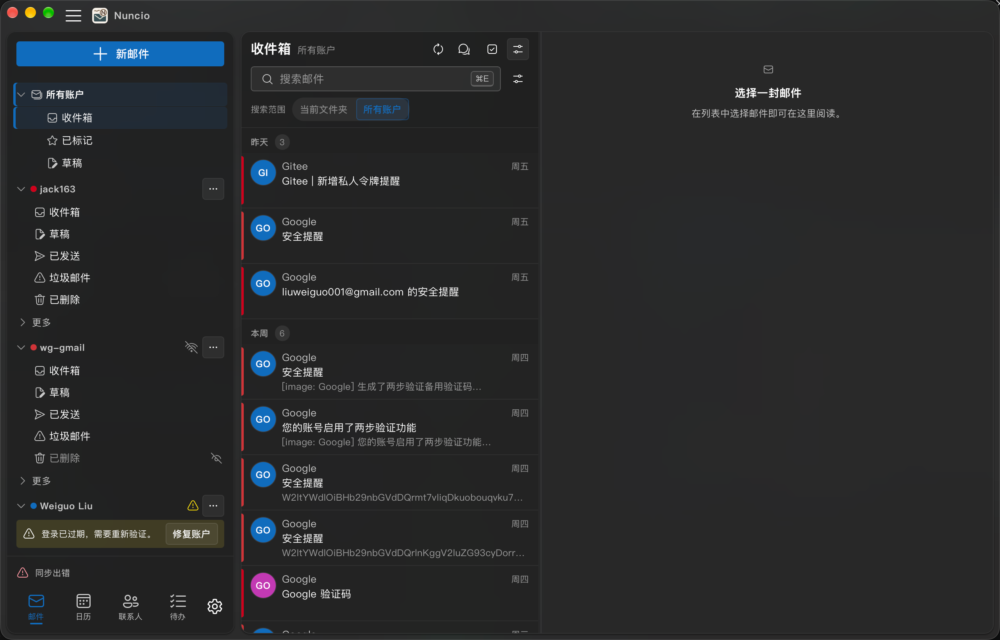
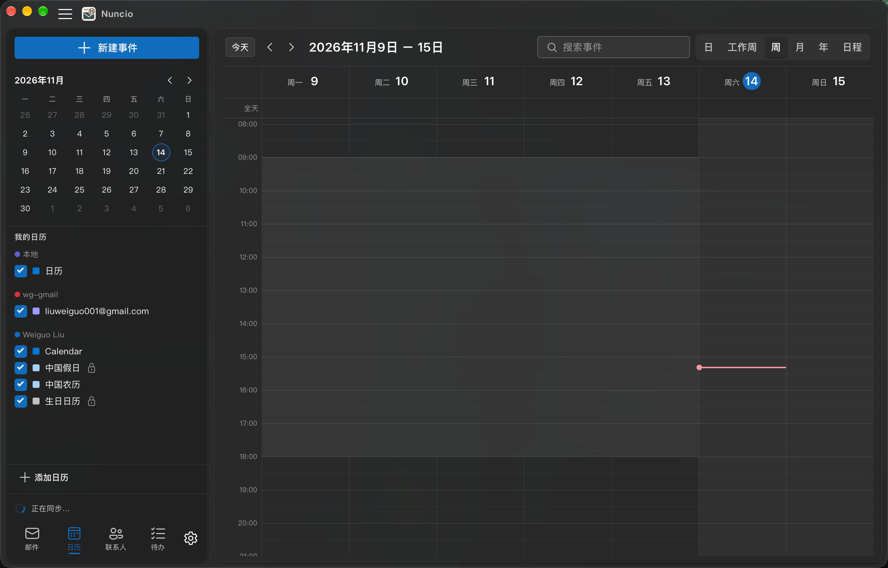
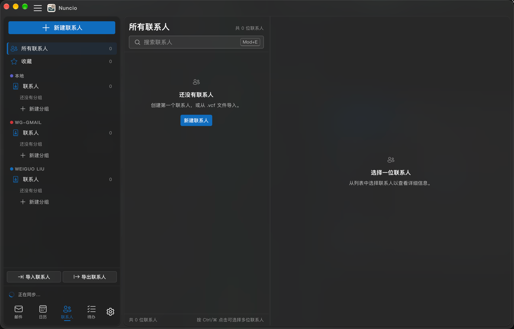
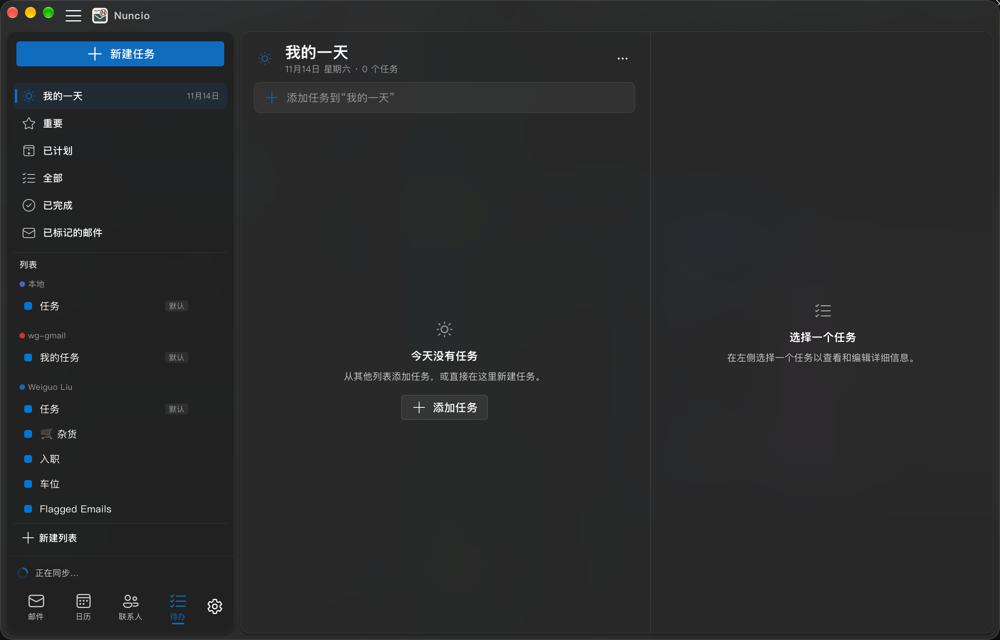
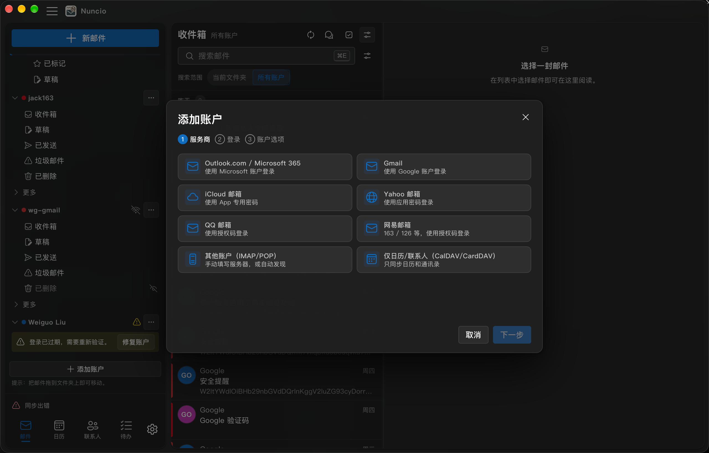

[English](README.md) | [简体中文](README.zh-CN.md)

<p align="center">
  
</p>

# Nuncio

A lightweight desktop client that keeps **mail, calendar, contacts and to-do** in one window. Its interaction is inspired by classic desktop mail and calendar apps, and it is written from scratch with [Tauri 2](https://v2.tauri.app/) + Rust + React.

- **No Nuncio backend.** Data moves directly between your computer and your own mail/calendar providers. No account system, no telemetry, no usage reporting. The only optional outbound requests are server discovery and the update check (see [Privacy](#privacy)).
- **Light.** Rust handles sync and storage; the WebView only draws the UI. Closing the main window destroys the WebView and keeps a small tray process.
- **No limits.** Unlimited accounts, no in-app purchases, no sign-in wall.

**Repository**: [GitHub](https://github.com/Jacksonary/nuncio) | [Gitee](https://gitee.com/weiguoliu/nuncio) · **Website**: <https://jacksonary.github.io/nuncio/> · **Privacy**: <https://jacksonary.github.io/nuncio/privacy.html>

## Screenshots

| Mail | Calendar |
|---|---|
|  |  |

| Contacts | To Do | Add account |
|---|---|---|
|  |  |  |

## Features

### Mail
- Accounts: Gmail, Outlook.com / Microsoft 365, iCloud, Yahoo, QQ / Foxmail, Tencent Exmail, 163 / 126 / yeah, Aliyun Mail, 139, Sina, Sohu, Fastmail, Zoho, Yandex, GMX, AOL, mail.ru, Proton Bridge, and any IMAP/SMTP/POP3 server.
- Auto-discovery: built-in presets → Thunderbird ISPDB → domain `autoconfig` → MX inference → `imap.` / `smtp.` guess.
- Sign-in: OAuth 2.0 authorization code + PKCE through the system browser with a loopback callback, or password / app password / authorization code.
- Sync: metadata-first IMAP sync, newest first; CONDSTORE deltas with UID-diff fallback and UIDVALIDITY resets; IDLE for new mail, with keep-alive and transparent reconnect; timed polling for other folders; catch-up after sleep/wake and network recovery.
- Offline operation queue: read/flag/move/archive/delete/junk apply locally first and replay with backoff; permanent failures roll back and notify.
- Outbox: queues while offline and retries automatically; drafts are saved locally and synced to the Drafts folder.
- Reading: HTML sanitized against an allowlist and rendered in a sandboxed iframe; remote images blocked by default with per-sender/domain trust; `cid:` inline images, plain-text fallback, raw headers, save/open `.eml`.
- Composing: reply / reply all / forward / forward as attachment / edit as new, signatures, multiple identities (send-as), staged attachments, pasted images, recipient suggestions, unsubscribe links.
- Conversation view, unified inbox, FTS5 full-text search (with Chinese bigram support), local rules, notifications and unread badge.

### Calendar
- Google Calendar (syncToken), Microsoft Graph (`events/delta`), CalDAV (`sync-collection` with ctag/ETag fallback), local calendars, `webcal` subscriptions.
- Day / work week / week / month / year / agenda views with drag-to-create, drag-to-move and resize.
- All-day events, time zones, RRULE, EXDATE, single-occurrence exceptions; `this` / `thisAndFollowing` / `all` edit scopes.
- Meeting invitations: parses `text/calendar` from mail, accepts / tentatively accepts / declines, replies via iTIP.
- Event reminders with snooze and dismiss.

### Contacts
- Google People API, Microsoft Graph contacts, CardDAV, local address books.
- Groups, favorites, photos, vCard 2.1/3.0/4.0 import and 3.0 export.
- Recipient history and autocomplete.

### To Do
- Google Tasks, Microsoft Graph To Do, CalDAV VTODO, local task lists.
- Smart lists: My Day, Important, Planned, All, Completed, Flagged email.
- Steps, importance, due dates, reminders, recurring tasks; capabilities the provider lacks degrade gracefully.
- "Create task" from a mail message, flagging the message.

### System integration
- Tray menu (Open / New message / Sync now / Quit); left click toggles the main window.
- Close-to-tray can destroy the WebView to free memory and rebuild it at the previous size.
- Windows Toast / Notification Center, Dock or taskbar unread badge.
- Launch at startup, window position and size remembered.
- `mailto:`, `webcal:` / `webcals:`, `.eml` / `.ics` / `.vcf` associations, single-instance forwarding.
- Links in messages show the full URL for confirmation and open in the system browser.
- Encrypted backup export/import (Argon2id + AES-256-GCM), optionally including credentials.
- Auto-update through a `latest.json` feed published to GitHub Releases and mirrored to Gitee, with minisign signature verification (see below).

## Download

Grab the installer from [GitHub Releases](https://github.com/Jacksonary/nuncio/releases) or [Gitee Releases](https://gitee.com/weiguoliu/nuncio/releases):

| Platform | Format |
|---|---|
| Windows 10/11 x64 | `.exe` (NSIS) |
| macOS (Apple Silicon) | `.dmg` |
| Linux x64 | `.deb` / `.AppImage` |

> Unsigned Windows builds trigger SmartScreen on first run. macOS builds are not notarized either: right-click → Open, or allow the app under System Settings → Privacy & Security. Removing the quarantine flag also works, but only for an installer you downloaded from the official Releases page and trust — it bypasses Gatekeeper's first-run check:
> ```bash
> xattr -cr /Applications/Nuncio.app
> ```

## Build from source

Prerequisites: Node.js 20+, Rust stable (developed with 1.97; CI tracks the current stable toolchain), and the Tauri 2 system dependencies for your platform.

```bash
npm ci
npm run tauri dev     # development
npm run tauri build   # production, artifacts in src-tauri/target/release/bundle
```

`createUpdaterArtifacts` is off by default, so a local build needs no updater signing key. The release workflow (`.github/workflows/release.yml`) turns it on with `--config '{"bundle":{"createUpdaterArtifacts":true}}'` when `TAURI_SIGNING_PRIVATE_KEY` is present, producing `.sig` files and `latest.json`; without the key it still publishes regular installers and skips the update artifacts.

On Linux install `libwebkit2gtk-4.1-dev`, `libjavascriptcoregtk-4.1-dev`, `libsoup-3.0-dev`, `librsvg2-dev`, `libayatana-appindicator3-dev` and `libdbus-1-dev` (see `.github/workflows/ci.yml`).

### OAuth client IDs

Google and Microsoft sign-in values are never committed:

```bash
cp .env.example .env.local
# edit .env.local:
# NUNCIO_GOOGLE_CLIENT_ID=...
# NUNCIO_GOOGLE_CLIENT_SECRET=...
# NUNCIO_MS_CLIENT_ID=...
```

`src-tauri/build.rs` injects `.env.local` as compile-time environment variables; the same names work as plain environment variables in CI. Settings → Advanced also accepts custom client IDs (they take precedence over build-time values). The step-by-step registration flow is in `docs/PLAN.md` appendices A (Google) and B (Microsoft).

### Update signing

In-app updates use the Tauri updater's minisign signature; `plugins.updater.pubkey` in `src-tauri/tauri.conf.json` must match the release key. The repository never stores the private key — it lives only in GitHub Secrets and the maintainer's password manager.

Maintainer setup:

1. The release key pair is generated once and must never be committed. To rotate it, run `npx tauri signer generate -w ~/.tauri/nuncio.key` (or `npm run tauri signer generate -- -w <path>`) and put the new `.key.pub` contents into `plugins.updater.pubkey`.
2. In the GitHub repository, Settings → Secrets and variables → Actions, add:
   - `TAURI_SIGNING_PRIVATE_KEY` — the full contents of the (unencrypted) private key file; a password-protected key additionally needs `TAURI_SIGNING_PRIVATE_KEY_PASSWORD`
   - `GITEE_TOKEN` — a Gitee personal access token, used by the `sync-to-gitee` job
   - `NUNCIO_GOOGLE_CLIENT_ID`, `NUNCIO_GOOGLE_CLIENT_SECRET`, `NUNCIO_MS_CLIENT_ID` — OAuth public-client identifiers injected at build time. Per Google's guidance for installed apps the client secret is not treated as confidential, but it is still never committed to source.
3. Pushing a `v*` tag makes `tauri-action` publish `.sig` files and `latest.json` for every platform; the Gitee job then mirrors the artifacts and rewrites `latest.json` download URLs to Gitee.

Without the signing key the workflow still builds and publishes installers, but skips updater artifacts (a warning is logged) and in-app "check for updates" finds no `latest.json`. Losing the private key means you cannot sign updates that existing installs accept; rotate the public key and publish a new release.

## Data locations

The data directory comes from Tauri's `app_local_data_dir`:

- Windows: `%LOCALAPPDATA%\app.nuncio.desktop\`
- macOS: `~/Library/Application Support/app.nuncio.desktop/`
- Linux: `~/.local/share/app.nuncio.desktop/`

```
nuncio.db            SQLite (WAL)
mime/<account>/…     cached raw MIME
attachments/<id>/    attachments downloaded on demand
staging/<draft>/     staged draft attachments
logs/                daily rolling logs, 7 files kept
tmp/                 temporary files
```

Passwords and OAuth refresh tokens live in the OS keychain, falling back to an AES-256-GCM encrypted file when no keychain is available. **The database never stores plaintext credentials.**

## Privacy

- There is no Nuncio backend; message bodies never pass through a third-party relay.
- No telemetry, crash reporting or usage statistics.
- The only optional outbound requests are Thunderbird ISPDB discovery (sends the mail domain to Mozilla; can be disabled in Settings) and the update check against GitHub Releases (with a Gitee mirror as fallback).

See the full [privacy policy](https://jacksonary.github.io/nuncio/privacy.html) (Chinese and English).

## Tech stack

| Layer | Technology |
|---|---|
| Shell | Tauri 2 (WebView2 / WKWebView / WebKitGTK) |
| Backend | Rust — IMAP (async-imap), SMTP (lettre), MIME (mail-parser / mail-builder), sanitizing (ammonia), iCalendar/vCard/REPEAT expansion (in-house on `rrule` + `calcard`), SQLite (rusqlite), OAuth (in-house PKCE) |
| Frontend | React 18 + TypeScript + Vite, TanStack Query / Virtual, Tiptap, Fluent-inspired CSS |
| CI | GitHub Actions (NSIS / DMG / DEB / AppImage) + Gitee mirror |

## License

Licensed under the [Apache License 2.0](LICENSE). Nuncio is an independent implementation inspired by [Wino Mail](https://github.com/bkaankose/Wino-Mail) (GPL-3.0); none of its source code is used. Icons and branding are original or use MIT-licensed Fluent System Icons.

## Buy Me a Beer

If Nuncio is useful to you, feel free to buy the author a beer 🍺

<p align="center">
  <table align="center"><tr>
    <td align="center">
      <br>WeChat
    </td>
    <td width="60"></td>
    <td align="center">
      <br>Alipay
    </td>
  </tr></table>
</p>
