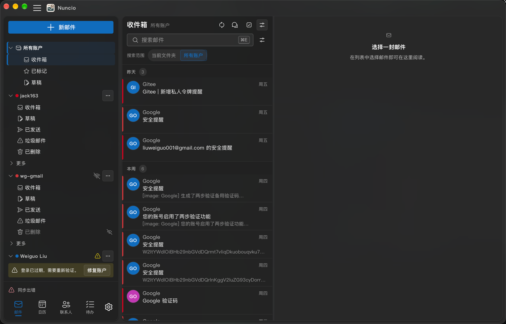
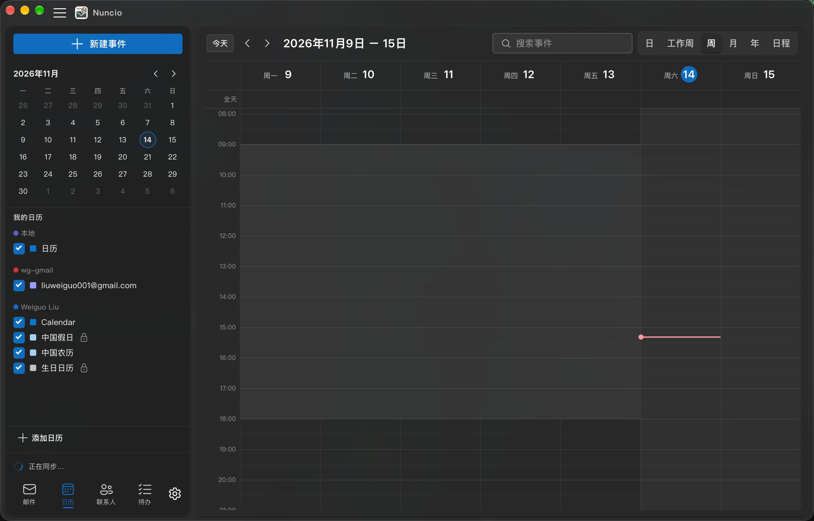
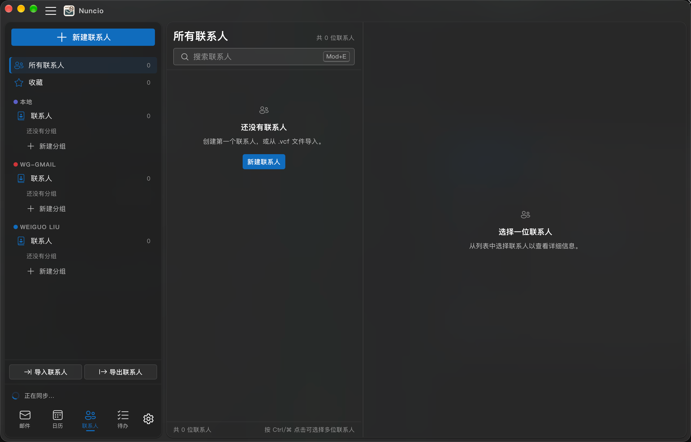
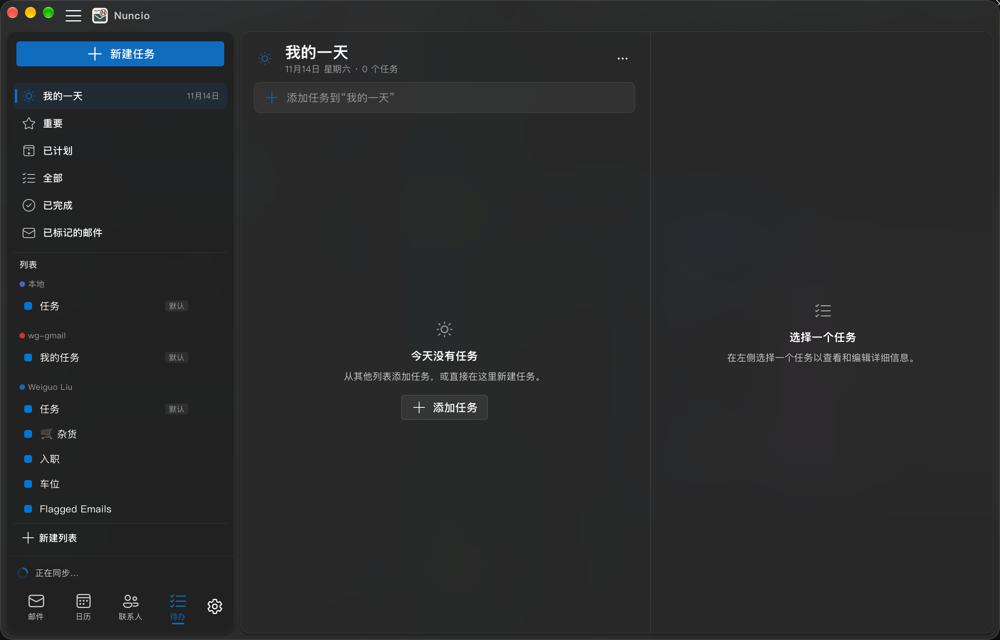
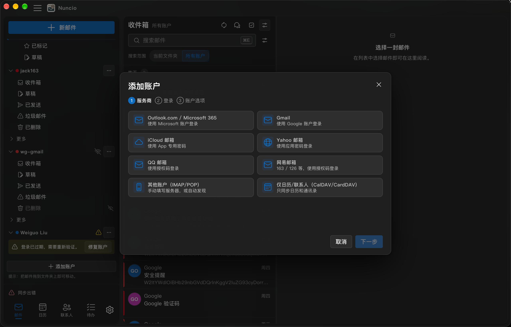

[English](README.md) | [简体中文](README.zh-CN.md)

<p align="center">
  
</p>

# Nuncio

把**邮件、日历、联系人、待办**放在同一个窗口里的轻量桌面客户端。交互受经典桌面邮件与日历应用启发，用 [Tauri 2](https://v2.tauri.app/) + Rust + React 从零实现。

- **零服务端**：数据直接在本机与邮件/日历服务商之间流动，没有 Nuncio 自建后端、没有账号体系、没有遥测、没有统计上报；仅有服务器自动发现与更新检查两类可选外发请求（见「隐私」）。
- **轻量**：Rust 负责同步与存储，WebView 只负责界面；关闭主窗口后销毁 WebView，托盘常驻内存保持在较低水平。
- **不限账户数**：无内购、无登录墙。

**仓库地址**：[GitHub](https://github.com/Jacksonary/nuncio) | [Gitee](https://gitee.com/weiguoliu/nuncio) · **官网**：<https://jacksonary.github.io/nuncio/> · **隐私政策**：<https://jacksonary.github.io/nuncio/privacy.html>

## 界面预览

| 邮件 | 日历 |
|---|---|
|  |  |

| 联系人 | 待办 | 添加账户 |
|---|---|---|
|  |  |  |

## 功能

### 邮件

- 账户：Gmail、Outlook.com / Microsoft 365、iCloud、Yahoo、QQ / Foxmail、腾讯企业邮、163 / 126 / yeah、阿里邮箱、139、新浪、搜狐、Fastmail、Zoho、Yandex、GMX、AOL、mail.ru、Proton Bridge，以及任意 IMAP/SMTP/POP3 服务器。
- 自动发现：内置服务商预设 → Thunderbird ISPDB → 域名 autoconfig → MX 推断 → `imap.` / `smtp.` 猜测。
- 登录方式：OAuth 2.0 授权码 + PKCE（系统浏览器 + 本地回环回调），或密码 / 应用专用密码 / 授权码。
- 同步：IMAP 元数据优先、最新优先分批同步；CONDSTORE 增量、UID 差异回退、UIDVALIDITY 重置；IDLE 收新邮件，带保活探测与透明重连；其他文件夹定时轮询；睡眠唤醒与断网恢复后补同步。
- 离线操作队列：已读/旗标/移动/归档/删除/垃圾邮件先本地生效，再按退避策略回放；永久失败回滚并提示。
- 发件箱：断网时排队，联网后自动重试；草稿本地保存并同步到 Drafts。
- 阅读：HTML 经白名单清洗后放入 `sandbox` iframe，远程图片默认拦截，可按发件人/域名信任；支持 `cid:` 内嵌图片、纯文本回退、原始邮件头、`.eml` 保存/打开。
- 撰写：回复 / 全部回复 / 转发 / 作为附件转发 / 作为新邮件编辑、签名、多身份（send-as）、附件暂存、粘贴图片、收件人补全、退订链接。
- 会话视图、合并收件箱、FTS5 全文搜索（支持中文 bigram）、本地规则、通知与未读角标。

### 日历

- Google Calendar（syncToken）、Microsoft Graph（`events/delta`）、CalDAV（`sync-collection`，回退 ctag/ETag）、本地日历、`webcal` 订阅。
- 日 / 工作周 / 周 / 月 / 年 / 议程视图，支持拖拽创建、拖动改期、拖动改时长。
- 全天事件、时区、RRULE、EXDATE、单次例外；`this` / `thisAndFollowing` / `all` 三种编辑语义。
- 会议邀请：解析邮件中的 `text/calendar`，接受 / 暂定 / 拒绝，通过 iTIP 回复。
- 事件提醒，支持稍后提醒和忽略。

### 联系人

- Google People API、Microsoft Graph contacts、CardDAV、本地通讯录。
- 分组、收藏、头像、vCard 2.1/3.0/4.0 导入与 3.0 导出。
- 收件人历史与自动补全。

### 待办

- Google Tasks、Microsoft Graph To Do、CalDAV VTODO、本地任务列表。
- 智能列表：我的一天、重要、计划内、全部、已完成、已标记邮件。
- 子步骤、重要性、到期日、提醒、重复任务；服务商不支持的能力会自动降级。
- 邮件「创建任务」并回写旗标。

### 系统集成

- 托盘菜单（打开 / 新邮件 / 立即同步 / 退出）、左键切换主窗口。
- 关闭到托盘时可销毁 WebView 以释放内存，再次打开会按原尺寸重建。
- 通知中心 / Windows Toast、Dock 或任务栏未读角标。
- 开机自启、窗口位置与大小记忆。
- `mailto:`、`webcal:` / `webcals:`、`.eml` / `.ics` / `.vcf` 文件关联与单实例转发。
- 邮件中的外部链接先弹出完整 URL 由用户确认，再用系统浏览器打开。
- 加密备份导出/导入（Argon2id + AES-256-GCM），可选择是否包含账户密码/token。
- 自动更新：通过 GitHub Releases 发布、并镜像到 Gitee 的 `latest.json`，配合 minisign 签名校验（见下方「自动更新签名」）。

## 下载安装

前往 [GitHub Releases](https://github.com/Jacksonary/nuncio/releases) 或 [Gitee Releases](https://gitee.com/weiguoliu/nuncio/releases) 下载对应平台的安装包：

| 平台 | 格式 |
|------|------|
| Windows 10/11 x64 | `.exe` (NSIS) |
| macOS（Apple Silicon / Intel） | `.dmg` |
| Linux x64 | `.deb` / `.AppImage` |

> 未签名的 Windows 构建首次运行会触发 SmartScreen；未公证的 macOS 构建需要右键「打开」，或在「系统设置 → 隐私与安全性」中放行。也可以清除隔离属性，但**仅限**从官方 Releases 页面下载并确认可信的安装包——这会绕过 Gatekeeper 的首次运行检查：
> ```bash
> xattr -cr /Applications/Nuncio.app
> ```

## 从源码构建

前置：Node.js 20+、Rust stable（开发使用 1.97，CI 跟随当前 stable）、对应平台的 Tauri 2 系统依赖。

```bash
npm ci
npm run tauri dev     # 开发模式
npm run tauri build   # 生产构建，产物在 src-tauri/target/release/bundle
```

`createUpdaterArtifacts` 默认关闭，因此本地构建**不需要** updater 签名私钥。发布流程（`.github/workflows/release.yml`）会在检测到 `TAURI_SIGNING_PRIVATE_KEY` 时用 `--config '{"bundle":{"createUpdaterArtifacts":true}}'` 自动开启，生成 `.sig` 与 `latest.json`；没有私钥时仍会正常发布安装包，只是跳过更新产物。

Linux 需要 `libwebkit2gtk-4.1-dev`、`libjavascriptcoregtk-4.1-dev`、`libsoup-3.0-dev`、`librsvg2-dev`、`libayatana-appindicator3-dev`、`libdbus-1-dev` 等依赖（见 `.github/workflows/ci.yml`）。

### OAuth Client ID

Google / Microsoft 登录所需的 Client ID 不写进源码：

```bash
cp .env.example .env.local
# 编辑 .env.local：
# NUNCIO_GOOGLE_CLIENT_ID=...
# NUNCIO_GOOGLE_CLIENT_SECRET=...
# NUNCIO_MS_CLIENT_ID=...
```

`src-tauri/build.rs` 会把 `.env.local` 作为编译期环境变量注入；打包时也可以直接设置同名环境变量。应用内「设置 → 高级」还可填写自定义 Client ID（优先于编译期值）。逐步申请流程见 `docs/PLAN.md` 附录 A（Google）与附录 B（Microsoft）。

### 自动更新签名

应用内更新使用 Tauri updater 的 minisign 签名，`src-tauri/tauri.conf.json` 的 `plugins.updater.pubkey` 必须与发布私钥配对。仓库**不保存私钥**：私钥只保存在 GitHub Secrets 和维护者的密码库中。

维护者配置：

1. 发布密钥对只生成一次，任何情况下都不要提交到仓库。需要轮换时执行 `npx tauri signer generate -w ~/.tauri/nuncio.key`（或 `npm run tauri signer generate -- -w <路径>`），并把新 `.key.pub` 的内容写入 `plugins.updater.pubkey`。
2. 在 GitHub 仓库 Settings → Secrets and variables → Actions 添加：
   - `TAURI_SIGNING_PRIVATE_KEY`：**未加密**私钥文件的完整内容；若私钥设置了密码，另外添加 `TAURI_SIGNING_PRIVATE_KEY_PASSWORD`
   - `GITEE_TOKEN`：Gitee 私人令牌，供 `sync-to-gitee` 任务使用
   - `NUNCIO_GOOGLE_CLIENT_ID`、`NUNCIO_GOOGLE_CLIENT_SECRET`、`NUNCIO_MS_CLIENT_ID`：构建期注入的 OAuth 公共客户端标识。按 Google 对已安装应用的定义，client secret 不属于机密信息，但仍不提交到源码。
3. 推送 `v*` tag 后，`tauri-action` 会生成并上传各平台的 `.sig` 与 `latest.json`，随后 Gitee 任务会同步产物并把 `latest.json` 里的下载地址改写为 Gitee。

未配置私钥时 release workflow 仍会构建并发布安装包，但会跳过 updater 产物（日志中给出 warning），此时应用内「检查更新」不会拿到 `latest.json`。私钥和密码丢失后无法再签发可被现有安装接受的更新，需要轮换公钥并发布新版本。

## 数据位置

数据目录由 Tauri 的 `app_local_data_dir` 决定：

- Windows：`%LOCALAPPDATA%\app.nuncio.desktop\`
- macOS：`~/Library/Application Support/app.nuncio.desktop/`
- Linux：`~/.local/share/app.nuncio.desktop/`

其中：

```
nuncio.db            SQLite（WAL）
mime/<account>/…     缓存的 MIME 原文
attachments/<id>/    按需下载的附件
staging/<draft>/     草稿附件暂存
logs/                日志（按天滚动，保留 7 个文件）
tmp/                 临时文件
```

密码与 OAuth refresh token 存在系统钥匙串；钥匙串不可用时退化为同目录下 AES-256-GCM 加密的文件。**数据库不保存明文凭据。**

## 隐私

- 没有自建服务端，邮件正文不经过任何第三方中转。
- 没有遥测、崩溃上报、使用统计。
- 仅有两类可选外发请求：Thunderbird ISPDB 自动发现（会把邮箱域名发给 Mozilla，可在设置中关闭），以及向 GitHub Releases（失败时回退到 Gitee 镜像）发起的更新检查。

完整说明见[隐私政策](https://jacksonary.github.io/nuncio/privacy.html)（中英双语）。

## 技术栈

| 层 | 技术 |
|---|---|
| 外壳 | Tauri 2（WebView2 / WKWebView / WebKitGTK） |
| 后端 | Rust —— IMAP（async-imap）、SMTP（lettre）、MIME（mail-parser / mail-builder）、清洗（ammonia）、iCalendar/vCard/重复展开（基于 `rrule` + `calcard` 自研）、SQLite（rusqlite）、OAuth（自研 PKCE） |
| 前端 | React 18 + TypeScript + Vite、TanStack Query / Virtual、Tiptap、Fluent 风格 CSS |
| 发布 | GitHub Actions（NSIS / DMG / DEB / AppImage）+ Gitee 同步 |

## 许可证

本项目基于 [Apache License 2.0](LICENSE) 开源。Nuncio 是独立实现，仅借鉴了 [Wino Mail](https://github.com/bkaankose/Wino-Mail)（GPL-3.0）的公开架构思路，未使用其任何源代码。图标与品牌素材为本项目自有或使用 MIT 许可的 Fluent System Icons。

## 打赏支持

如果这个项目对你有帮助，欢迎请作者喝瓶啤酒 🍺

<p align="center">
  <table align="center"><tr>
    <td align="center">
      <br>微信
    </td>
    <td width="60"></td>
    <td align="center">
      <br>支付宝
    </td>
  </tr></table>
</p>
